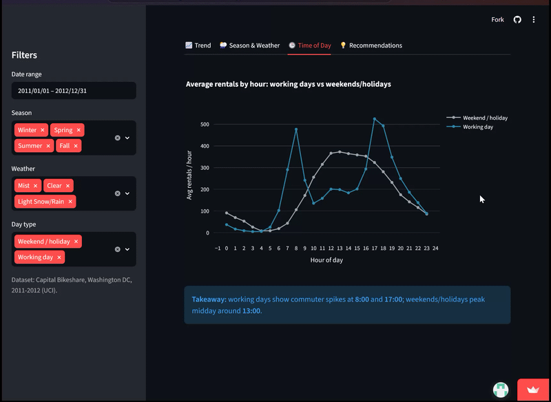

# Bike Sharing Exploratory Data Analysis

An end-to-end analysis of two years of Capital Bike share system, delivered as an interactive Streamlit dashboard.

**[Live dashboard](https://bike-sharing-ardhm.streamlit.app/)** · **[Analysis notebook](notebook.ipynb)**



## Business Problem

A bike-sharing operator needs to know when and why demand changes so it can stock stations, schedule maintenance and target promotions. This project answers three questions:

1. How many bike shares were used, and how do they compare between 2011 and 2012?
2. How do weather and seasons affect the average number of bike shares during 2011–2012 to meet rental demand?
3. How does bike sharing usage differ between working days and holidays during 2011–2012 to adjust bike supply?

## Key Findings

| Question | Finding |
|---|---|
| Growth | 3,292,679 rentals over two years (avg 4,504/day). 2012 was **+64.9%** vs 2011; registered riders +68.4%. |
| Season | Fall is the peak (5,644 rentals/day); Spring is about **54% lower** (2,604/day). |
| Weather | Clear days average 4,877 rentals vs 1,803 on light rain/snow days (**about 63% lower**; only 21 rainy days, so indicative). |
| Time of day | Working days peak at **8 AM and 5–6 PM** (commuting; only 13% of rentals are casual). Weekends peak around **1 PM** (leisure; 32% casual). |

## Recommendations
- **Rebalance Bikes by Time of Day:** On working days, stock commuter hubs before 8 AM and 5 PM. On weekends, move bikes toward leisure areas for the midday peak.

- **Weekend Promotions:** To increase Bike Share usage on weekends, consider offering special promotions such as weekend discounts or morning-specific promotions. These initiatives could help increase rental activity during the morning, similar to weekday patterns, while also encouraging a healthy lifestyle through morning cycling.
- **Plan Around Season and Weather:** Schedule maintenance and fleet reductions in spring, and run campaigns in summer and winter. Consider a rain-day discount or weather alert, since rainy days lose about 63% of demand.

## Dashboard Features

- KPI cards: total rentals, average per day, registered share, 2012 vs 2011 growth
- Sidebar filters for date range, season, weather and day type, applied to every chart
- Tabs for Trend, Season & Weather, Time of Day and Recommendations
- A data-driven takeaway under each chart that updates with the filters

## Approach

1. **Data wrangling:** assessed missing values, duplicates, data types and consistency between casual + registered and total counts; decoded categorical columns; renamed columns.
2. **EDA:** distributions, daily/monthly/yearly usage, relationships with season, weather and time.
3. **Visualisation and explanatory analysis:** one section per business question.
4. **Dashboard:** built with Streamlit and Plotly, deployed on Streamlit Community Cloud.

## Tech Stack

Python · pandas · NumPy · Plotly · Matplotlib · Seaborn · Streamlit


## Project Structure
```
├── dashboard/
│   ├── dashboard.py        # Streamlit app
│   ├── day_clean.csv       # cleaned daily data
│   └── hour_clean.csv      # cleaned hourly data
├── data/                   # raw data (day.csv, hour.csv)
├── notebook.ipynb          # wrangling, EDA, visualisation, conclusions
├── requirements.txt
└── README.md
```

## Installation
### Setup Environment - Anaconda
```
conda create --name main-ds python=3.10
conda activate main-ds
pip install -r requirements.txt
```

### Setup Environment Shell/Terminal
```
mkdir proyek_analisis_data
cd proyek_analisis_data
pipenv install
pipenv shell
pip install -r requirements.txt
```

### Run Streamlit
```
streamlit run dashboard.py
```

## Data
[Bike Sharing Dataset](https://www.kaggle.com/datasets/lakshmi25npathi/bike-sharing-dataset), Kaggle.

## Author

Ardhianda Maulana · [LinkedIn](https://www.linkedin.com/in/ardhi-m/) · [GitHub](https://github.com/ardhii-m)